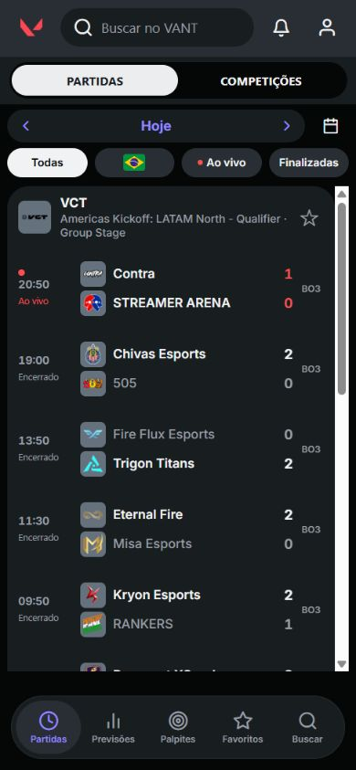
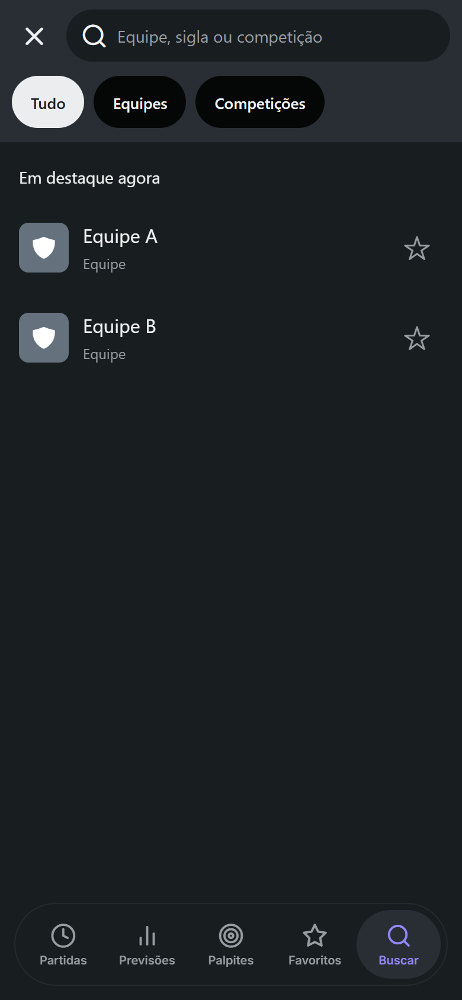
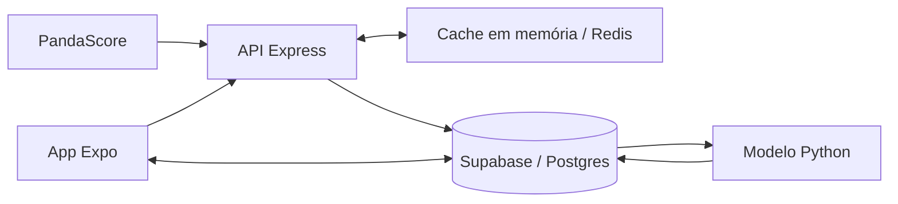

# VANT

Aplicativo para acompanhar o competitivo de Valorant: partidas, favoritos, palpites e previsões em português.

**[Baixar APK Android](https://github.com/Lefanyway/vant-app/releases/download/v1.0.0/VANT-1.0.0.apk)**

Baixe e abra o APK no celular para instalar.

## O app

<table>
<tr><th>Partidas</th><th>Previsões</th><th>Busca</th></tr>
<tr>
<td></td>
<td></td>
<td></td>
</tr>
</table>

Capturas da versão web em formato de celular. Partidas usa dados da API; as demais telas usam dados demonstrativos.

## Recursos

- **Partidas:** agenda, placares e resultados, com filtros por dia e destaque para o Brasil.
- **Previsões:** chances de vitória, explicação dos fatores, simulador e ranking Elo.
- **Palpites:** escolha do placar, pontuação e liga semanal.
- **Favoritos:** acompanhe equipes e competições.
- **Busca:** encontre times, campeonatos e seus detalhes.
- **Perfil:** nick, avatar e modo sem spoiler.

## Como funciona

## As previsões

O modelo combina Elo e regressão logística para estimar a chance de vitória de cada time. Considera força, forma recente, confrontos diretos, experiência, descanso e formato da série. O app mostra os fatores da previsão e permite simular confrontos.
