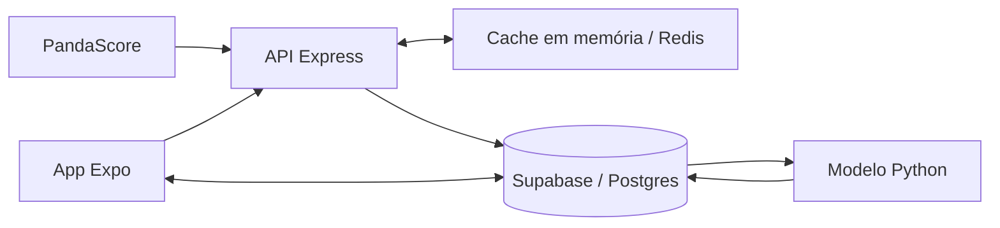

<div align="center">

# VANT

**Valorant competitivo, fácil de acompanhar.**

Partidas, favoritos, palpites e previsões explicadas — em português do Brasil.

**React Native · Expo · TypeScript · Supabase · Python**

[O app](#o-app) · [Rodar localmente](#rodar-localmente) · [APK Android](#gerar-o-apk-android) · [Documentação](#documentação)

</div>

## O app

O VANT reúne o cenário competitivo de Valorant em um app mobile. Acompanhe seus times, explore campeonatos e compare sua leitura de um confronto com as probabilidades do modelo.

<table>
<tr><th>Primeiros passos</th><th>Previsões</th><th>Busca</th></tr>
<tr>
<td></td>
<td></td>
<td></td>
</tr>
</table>

Capturas da versão web em viewport de celular, com dados demonstrativos. Resultados e métricas variam conforme a atualização das fontes.

## Recursos

- **Partidas** — agenda, placares e resultados por dia, com filtros e destaque para o cenário brasileiro.
- **Previsões** — probabilidades de vitória, explicação dos fatores, simulador de confrontos e ranking Elo.
- **Palpites** — escolha do placar da série, pontos, sequência de acertos e liga semanal.
- **Favoritos** — equipes e competições seguidas, com configuração de avisos.
- **Buscar** — pesquisa por nome ou sigla e acesso aos detalhes dos times e campeonatos.
- **Perfil** — nick, avatar e modo sem spoiler.

## Como funciona



O app consulta a API para os dados de esports e o Supabase para autenticação, perfil, favoritos e previsões. O servidor mantém o token da PandaScore e usa cache para reduzir consultas repetidas.

O modelo combina **Elo e regressão logística**, considerando força, forma recente, confrontos diretos, experiência, descanso e formato da série. O backtest usa as informações disponíveis antes de cada partida. As métricas e os motivos das previsões aparecem no próprio app.

## Tecnologias

| Camada | Ferramentas |
| --- | --- |
| App | React Native, Expo Router, TypeScript, TanStack Query, Reanimated |
| API | Node.js, Express, TypeScript, esbuild |
| Dados e contas | Supabase, PostgreSQL, Row Level Security |
| Cache | Memória do servidor, Redis opcional, AsyncStorage |
| Modelo | Python, NumPy, scikit-learn |
| Testes | Jest, Testing Library, Node Test Runner, unittest |
| Automação | GitHub Actions, Expo EAS |

## Rodar localmente

### Pré-requisitos

- Node.js 24 e pnpm 11.
- Expo Go no celular e computador na mesma rede Wi-Fi.
- Projeto Supabase configurado e token da PandaScore.

```bash
git clone https://github.com/Lefanyway/vant_app.git
cd vant_app
pnpm install --frozen-lockfile
```

### Configurar o ambiente

Crie `artifacts/esports-score/.env` com os dados públicos do projeto.

```dotenv
EXPO_PUBLIC_SUPABASE_URL=https://SEU_PROJETO.supabase.co
EXPO_PUBLIC_SUPABASE_KEY=SUA_CHAVE_PUBLICAVEL
```

Crie `artifacts/api-server/.env` para a API.

```dotenv
PANDASCORE_API_TOKEN=SEU_TOKEN
SUPABASE_URL=https://SEU_PROJETO.supabase.co
SUPABASE_PUBLISHABLE_KEY=SUA_CHAVE_PUBLICAVEL
```

Aplique as migrações de `supabase/migrations`. A sincronização e o treino exigem também a chave de ingestão. As credenciais privadas ficam no servidor. Consulte a configuração completa no [guia do Supabase](docs/supabase.md).

### Abrir no celular

```bash
pnpm run dev:phone
```

O comando inicia a API e o Expo, configura o IP da rede local e mostra o QR Code para o Expo Go. No Windows, também é possível executar `ABRIR-VANT.cmd`. O [guia para abrir no celular](docs/abrir-no-celular.md) detalha o login e o diagnóstico de conexão.

### Versão web

```bash
pnpm run build:web
pnpm run start:web
```

A versão web fica disponível na porta 5000 por padrão. Para uma API hospedada separadamente, configure `EXPO_PUBLIC_API_BASE_URL` com seu endereço público antes de gerar o app.

## Gerar o APK (Android)

O perfil `preview` do EAS gera um APK instalável. Cadastre no ambiente `preview` as variáveis `EXPO_PUBLIC_API_BASE_URL`, `EXPO_PUBLIC_SUPABASE_URL` e `EXPO_PUBLIC_SUPABASE_KEY`.

```bash
cd artifacts/esports-score
npx eas-cli build -p android --profile preview
```

Ao terminar, o EAS fornece o link de download. Para acessar o app fora da rede de desenvolvimento, a API precisa estar disponível na internet.

## Testes

```bash
pnpm run typecheck
pnpm test
python -m pip install -r ml/requirements.txt
python -m unittest discover -s ml -p "test_train.py"
```

O [relatório de qualidade](docs/RELATORIO-QUALIDADE.md) registra a cobertura da auditoria e suas limitações.

## Estrutura

```text
artifacts/
  esports-score/       App Expo e telas
  api-server/          API de esports e cache
ml/                    Treino e avaliação do modelo
supabase/migrations/   Banco de dados e políticas de acesso
services/              Serviços auxiliares
scripts/               Desenvolvimento e build
docs/                  Guias, arquitetura e capturas
```

## Documentação

- [Arquitetura e fluxos](docs/ARQUITETURA.md)
- [Banco e sincronização](docs/supabase.md)
- [Abrir no celular](docs/abrir-no-celular.md)
- [Relatório de qualidade](docs/RELATORIO-QUALIDADE.md)
- [Roadmap](docs/ROADMAP.md)

## Sobre o projeto

Desenvolvido por **Lefanyway** como projeto acadêmico, sem fins comerciais. A disponibilidade dos detalhes de partidas depende da cobertura e do plano dos provedores.

## Aviso legal

VANT não é endossado pela Riot Games e não reflete as opiniões da Riot Games nem de ninguém oficialmente envolvido na produção ou gestão das propriedades da Riot Games. Riot Games, VALORANT e todas as propriedades associadas são marcas comerciais ou marcas registradas da Riot Games, Inc. Dados de partidas fornecidos pela PandaScore. Fotos de jogadores: Liquipedia (CC BY-SA 3.0).
