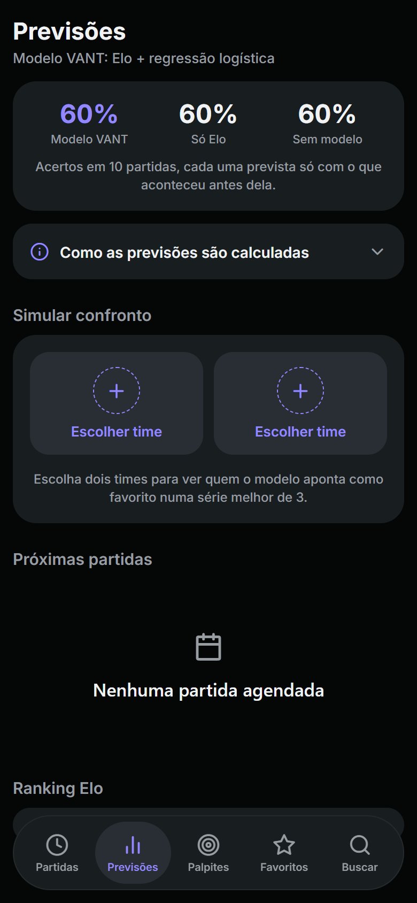
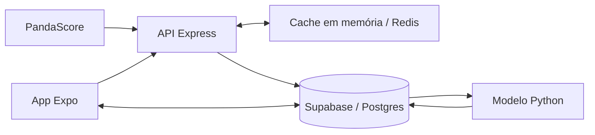

# VANT

O VANT reúne o competitivo de Valorant em um aplicativo em português. A proposta é facilitar o acompanhamento de partidas e equipes, com agenda, placares, palpites e previsões explicadas.

**[Baixar APK Android](https://github.com/Lefanyway/vant-app/releases/download/v1.0.0/VANT-1.0.0.apk)**

Baixe e abra o APK no celular para instalar.

## O app

<table>
<tr><th>Onboarding</th><th>Partidas</th><th>Previsões</th></tr>
<tr>
<td></td>
<td></td>
<td></td>
</tr>
</table>

Capturas da versão web em formato de celular. Partidas usa dados da API; Previsões usa dados demonstrativos.

## Recursos

- **Partidas:** agenda, placares e resultados, com filtros por dia e destaque para o Brasil.
- **Previsões:** chances de vitória, explicação dos fatores, simulador e ranking Elo.
- **Palpites:** escolha do placar, pontuação e liga semanal.
- **Favoritos:** acompanhe equipes e competições.
- **Busca:** encontre times, campeonatos e seus detalhes.
- **Perfil:** nick, avatar e modo sem spoiler.

## Como funciona

Os dados circulam entre quatro partes:

1. **API:** consulta a PandaScore para buscar partidas, resultados, equipes e competições. Organiza as respostas para o app e mantém o token do provedor no servidor.
2. **Banco:** o Supabase guarda o histórico de partidas, as previsões e os dados de cada conta, como perfil, favoritos e palpites. Também cuida do login e das permissões de acesso.
3. **Cache:** a API reutiliza dados em memória e no Redis para reduzir consultas repetidas. O app também salva parte dos dados no aparelho para agilizar a próxima abertura.
4. **Modelo:** um processo em Python lê o histórico no banco, calcula a força das equipes e grava as probabilidades que aparecem no app.

A API está hospedada no Render. Os workflows do GitHub Actions estão configurados para sincronizar os dados a cada hora, treinar o modelo duas vezes por dia e executar os testes a cada alteração no repositório.

## As previsões

O modelo combina **Elo e regressão logística**. O Elo acompanha a força das equipes a partir dos resultados; a regressão combina essa informação com forma recente, confrontos diretos, experiência, descanso e formato da série para estimar a chance de vitória.

No app, é possível ver os fatores de cada previsão, comparar equipes no simulador e acompanhar o desempenho do modelo. A avaliação respeita a ordem das partidas: usa apenas as informações disponíveis antes de cada confronto.

## Tecnologias

| Parte | Tecnologias |
| --- | --- |
| Aplicativo | React Native, Expo, TypeScript e TanStack Query |
| API | Node.js e Express |
| Banco e autenticação | Supabase e PostgreSQL |
| Cache | Redis e AsyncStorage |
| Previsões | Python, NumPy e scikit-learn |
| Build e automação | Expo EAS e GitHub Actions |
