# VANT — documentação técnica

Como o VANT é construído: as partes, como os dados circulam, as telas, o banco, a API, o modelo de previsão e como gerar cada versão. Os diagramas usam Mermaid e aparecem desenhados no GitHub.

## 1. Visão geral

O VANT acompanha partidas de Valorant para o público brasileiro: agenda e placares ao vivo, competições, equipes, favoritos com avisos, uma previsão própria de quem vence e um bolão de palpites.

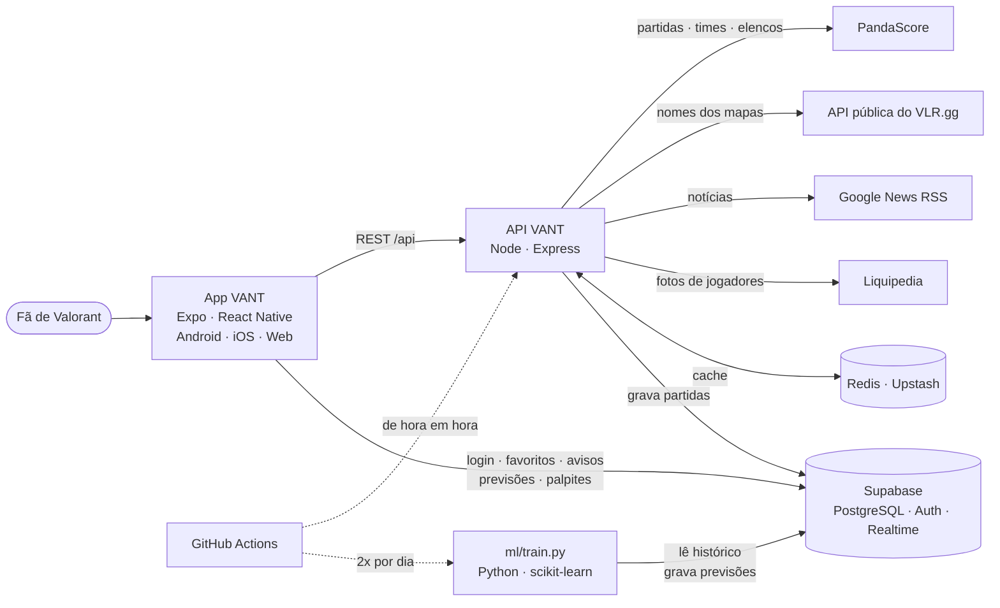

| Parte | Pasta | Tecnologias | Responsabilidade |
|---|---|---|---|
| App | `artifacts/esports-score` | React Native 0.88, React 19, Expo 58, Expo Router, TanStack Query, Supabase JS, Reanimated | Telas, navegação, cache no aparelho, login, favoritos, palpites |
| API | `artifacts/api-server` | Node 24, Express 5, esbuild, Redis (Upstash) | Esconde o token da PandaScore, junta e normaliza dados, cache, proxy de logos, agenda `.ics` |
| Banco | `supabase/migrations` | PostgreSQL, Auth, RLS, Realtime | Partidas salvas, contas, favoritos, notificações, previsões, palpites |
| Modelo | `ml` | Python 3.12, scikit-learn, NumPy | Elo + regressão logística; grava uma previsão por partida |
| Automação | `.github/workflows` | GitHub Actions | Testes a cada envio, sincronização horária, treino do modelo |

## 2. Mapa do repositório

```
VANT/
├─ artifacts/
│  ├─ esports-score/          App (Expo)
│  │  ├─ app/                 Telas: cada arquivo é uma rota (Expo Router)
│  │  │  ├─ (tabs)/           Partidas · Previsões · Palpites · Favoritos · Buscar
│  │  │  ├─ match/[id]        Partida
│  │  │  ├─ teams/[id]        Equipe
│  │  │  ├─ competitions/[id] Competição
│  │  │  ├─ login/            E-mail → senha · criar conta
│  │  │  └─ onboarding, profile, notifications, favorites/add
│  │  ├─ components/          Peças de interface reutilizadas
│  │  ├─ context/             Sessão, favoritos, notificações, modo sem spoiler
│  │  ├─ lib/                 Chamadas à API, modelo no app, palpites, navegação, cache
│  │  ├─ assets/              Ícone, bandeiras, avatares, logos de times
│  │  └─ __tests__/           Testes (Jest + Testing Library)
│  └─ api-server/             API
│     └─ src/
│        ├─ routes/           Rotas HTTP
│        ├─ providers/esports PandaScore, Supabase (leitura, gravação, sincronização), cache, logos
│        └─ lib/              Logger, Redis, disparo do treino
├─ ml/                        Treino do modelo e testes
├─ supabase/migrations/       Esquema do banco, em ordem
├─ scripts/                   Abrir no celular, build da versão web
└─ docs/                      Esta documentação, roadmap, Supabase, identidade visual
```

## 3. Mapa de telas

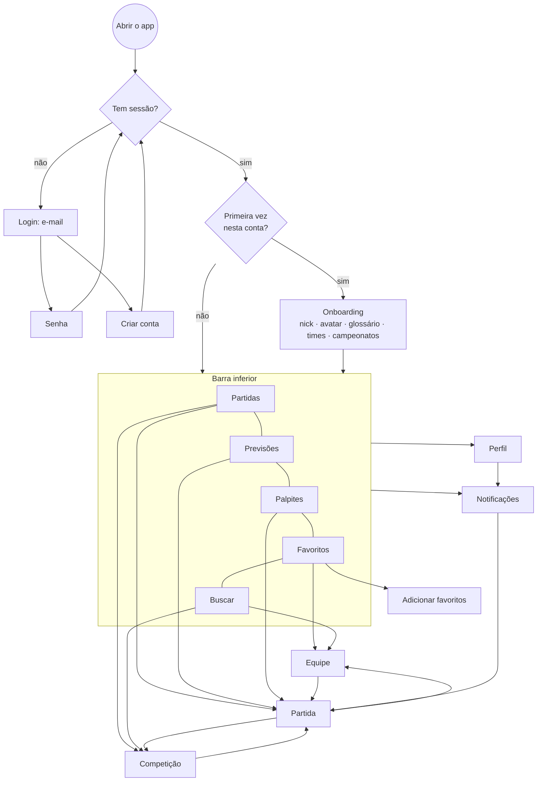

| Tela | Ação principal | Fontes de dados |
|---|---|---|
| Partidas | Escolher o dia; filtro Brasil | `/matches`, `/matches/live`, `/matches/upcoming`, `/matches/recent` |
| Previsões | Ver quem deve ganhar e por quê; simular confronto | Supabase: `model_runs`, `predictions`, `matches`, `team_elo` |
| Palpites | Palpitar vencedor ou placar; liga da semana | Supabase: `picks`, `pick_split`, `pick_leaderboard` |
| Favoritos | Ver os jogos de quem segue | `/teams/:id/matches`, `/competitions/:id/matches` |
| Buscar | Achar time ou campeonato | `/catalog` (busca aproximada no banco) |
| Partida | Placar, mapas, chance de vitória, onde assistir | `/matches/:id`, `/details`, `/maps`, `predictions` |
| Equipe | Seguir; agenda no celular | `/teams/:id/overview`, `/news`, `/roster`, `/stats`, `/calendar.ics` |
| Competição | Próximas e resultados | `/competitions/:id`, `/competitions/:id/matches` |
| Perfil | Avisos por favorito; sem spoiler | Supabase: `profiles`, `favorites` |

## 4. Fluxos

### 4.1 Abrir o app

O app abre com a última cópia salva no aparelho e atualiza por trás, sem tela vazia.

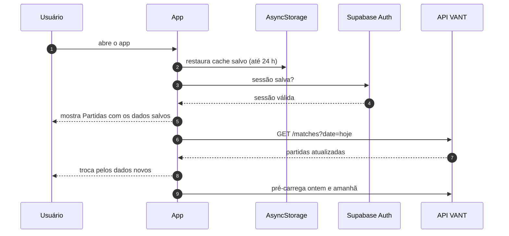

### 4.2 Abrir uma partida

O toque já começa a buscar os dados (`warmMatch`) antes da tela abrir. Partidas encerradas vêm do banco; ao vivo, só o placar vem da PandaScore.

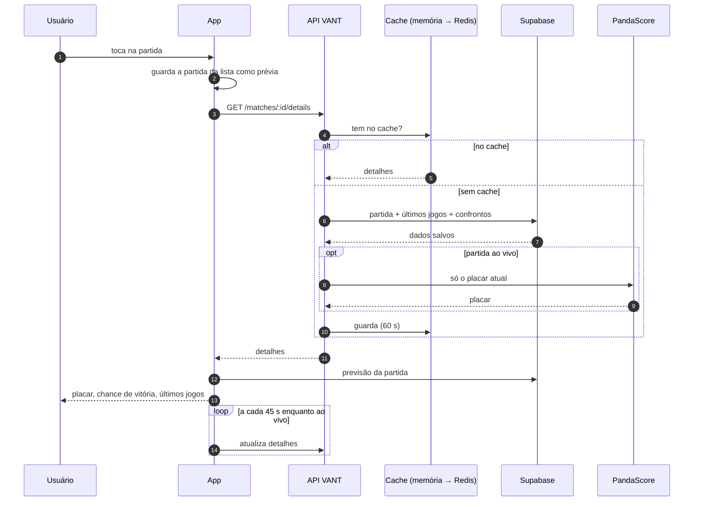

### 4.3 Sincronização com a PandaScore

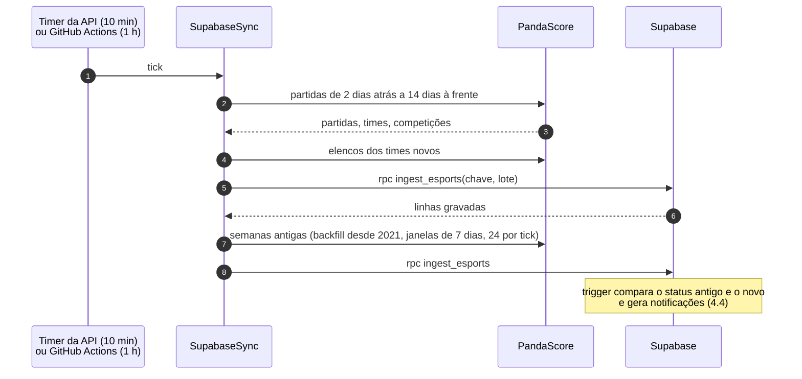

### 4.4 Notificações

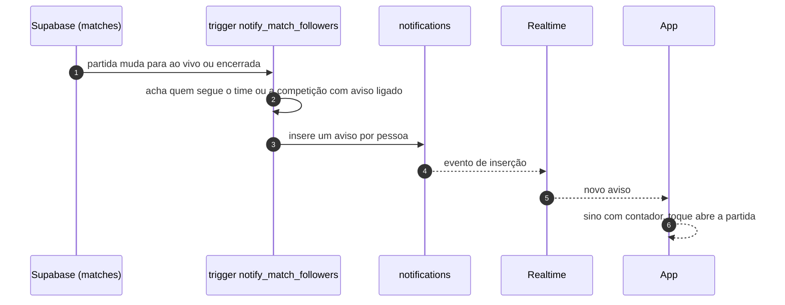

### 4.5 Previsão de vitória

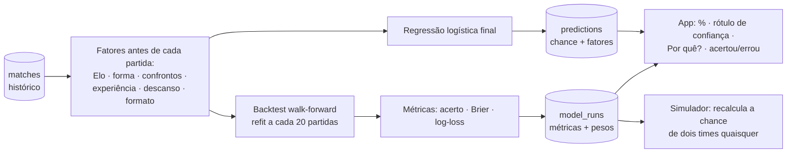

O app refaz a mesma conta do modelo (soma dos pesos × fatores, depois a função logística), por isso o "Por quê?" mostra exatamente o que pesou em cada previsão. Resultado atual: 64% de acerto em 13.794 partidas testadas sem olhar o futuro (só Elo: 63%; moeda: 53%).

### 4.6 Palpites

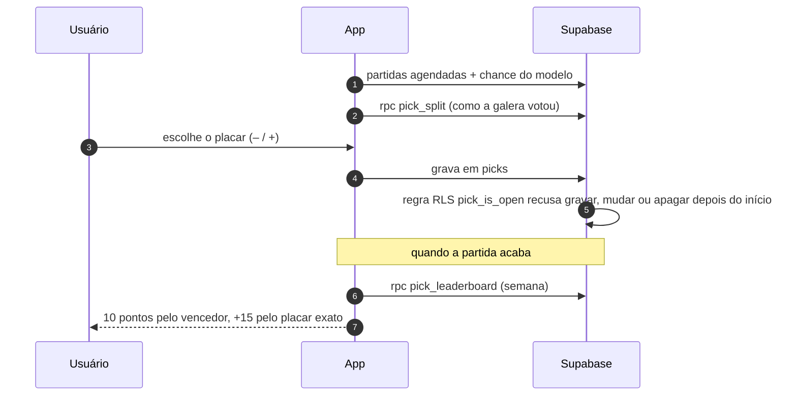

## 5. Modelo de dados

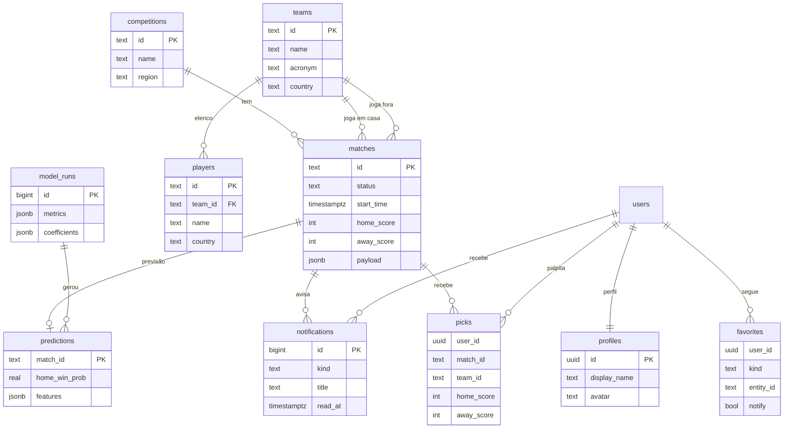

- `matches.payload` guarda a partida no formato da API, para o app ler direto do banco sem conversão.
- `team_elo` é uma visão: o Elo mais recente de cada time, tirado das previsões.
- Dados de esports só entram pelas funções `ingest_esports` e `ingest_predictions`, que exigem uma chave guardada com hash em `private.ingest_keys`.
- RLS: cada usuário lê e grava só os próprios favoritos, notificações, perfil e palpites; partidas, times, previsões e métricas são públicos para leitura.

## 6. API

Base: `/api`. Respostas em JSON (a agenda é `text/calendar`). Erros seguem `{ error, code, retryable }`.

| Rota | O que devolve | Cache |
|---|---|---|
| `GET /healthz` · `/healthz/cache` | Estado da API e do Redis | — |
| `GET /matches?date&timezone&game` | Partidas do dia (do banco quando o dia já foi sincronizado) | 2 min hoje · 5 min futuro · 1 h passado |
| `GET /matches/live` | Partidas ao vivo | 20 s |
| `GET /matches/upcoming` | Próximas partidas | 5 min |
| `GET /matches/recent?country=BR` | Últimos resultados de times de um país | 2 min |
| `GET /matches/:id` · `/details` · `/maps` | Partida, detalhes (últimos jogos, confrontos), mapas e rounds | 60 s |
| `GET /competitions` · `/:id` · `/:id/matches` | Competições e suas partidas | 6 h · 2 min |
| `GET /teams/:id` · `/overview` · `/matches` · `/roster` · `/stats` · `/news` | Equipe, resumo, partidas, elenco, estatísticas de 30 dias, notícias | 6 h · 1 h · 3 h · 6 h · 15 min |
| `GET /teams/:id/calendar.ics` | Próximos jogos para a agenda do celular (lembrete de 15 min) | 1 h |
| `GET /catalog?type&page&q` | Busca de times e competições, paginada e ordenada por relevância | 30 min sem busca · 6 h com busca |
| `GET /esports/assets/logo?url` | Proxy de logos (só hosts permitidos, PNG redimensionado, SVG higienizado) | 7 dias no navegador |
| `GET /debug/providers` | Estado da PandaScore (só em desenvolvimento) | — |

Entradas inválidas (data, jogo, filtro, página, país) recebem `400`; IDs inexistentes, `404`.

## 7. Cache em camadas

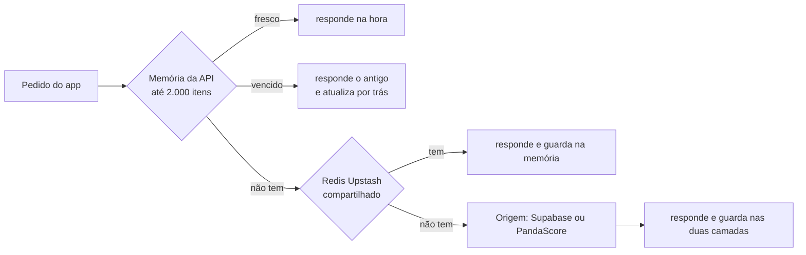

- O dado vencido continua sendo servido enquanto a atualização acontece: por mais um TTL nos dados ao vivo e por até 15 minutos nas listas.
- Pedidos iguais ao mesmo tempo viram uma só ida à origem.
- No aparelho, o React Query guarda partidas, competições, previsões, equipes e detalhes de partida por 24 h (AsyncStorage). A versão do cache (`buster`) sobe quando o formato muda.
- Ao tocar numa partida ou equipe, os dados da próxima tela já começam a carregar.

## 8. Segurança e privacidade

- O token da PandaScore e a chave de gravação do Supabase ficam só na API (`.env`, fora do Git). O app só tem a chave pública do Supabase.
- RLS em todas as tabelas de usuário; funções de gravação com `security definer` e chave com hash.
- O proxy de logos aceita só hosts conhecidos, HTTPS, sem redirecionamento, e limita o tamanho; SVG passa por higienização.
- Mensagens de erro da API não repetem valores enviados; o app mostra textos próprios em português.

## 9. Acessibilidade

- Todo controle tem rótulo em português (`accessibilityLabel`).
- Estado dos controles com atributos `aria-*` (`aria-selected`, `aria-checked`, `aria-expanded`), que funcionam no TalkBack/VoiceOver e no navegador.
- Ordem de Tab segue a leitura da tela: cabeçalho → abas → data → filtros → lista → barra inferior.
- Animações respeitam "reduzir movimento"; área de toque mínima de 44 px.

## 10. Build e execução

| Alvo | Como | Observação |
|---|---|---|
| Celular em desenvolvimento | `pnpm run dev:phone` | Sobe a API (5000) e o Expo (8081) com o IP do Wi-Fi |
| Web | `pnpm run build:web` e `pnpm run start:web` | A API serve o app web exportado |
| APK Android | `npx eas-cli build -p android --profile preview` em `artifacts/esports-score` | Build na nuvem da Expo; variáveis no ambiente `preview` do EAS |
| Modelo | `pnpm run ml:train` | Também roda sozinho pela API e pelo GitHub Actions |
| Testes | `pnpm test` e `python -m unittest discover ml` | Mesmos comandos do CI |

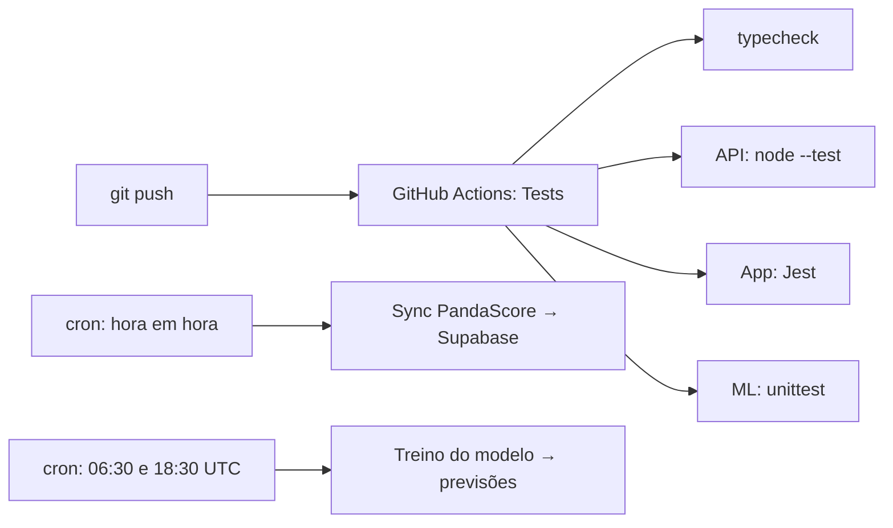

## 11. Decisões e limites

- **Monorepo simples (pnpm), sem microsserviços:** uma API e um app bastam para o tamanho do projeto.
- **Banco como fonte principal:** partidas já sincronizadas vêm do Supabase; a PandaScore só é chamada para o que muda (ao vivo, dias próximos).
- **Modelo explicável em vez de "caixa-preta":** a regressão logística permite mostrar o peso de cada fator ao usuário.
- **Plano grátis da PandaScore:** sem estatísticas de jogador nem economia; os nomes dos mapas vêm da API pública do VLR.gg.
- **Pendências:** API publicada na internet (hoje roda no computador de quem desenvolve) e push com o app fechado; ver `docs/ROADMAP.md`.
